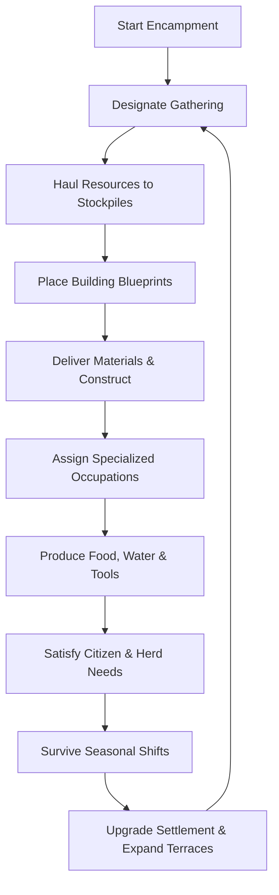

# DEWABHUMI — Master Game Design Document

Status: **Active Living Design Contract**  
Engine Target: **Unity 6 (URP)**  
Genre: **Historical Settlement Survival Simulator**  
Perspective: **Fixed 2.5D Isometric / Orthographic View**

---

## 1. Product Statement

**Dewabhumi** is a historically inspired Himalayan settlement survival simulator set in the dramatic geography of the Kathmandu Valley. The player acts as the founder and leader of a fledgling clan community, carving out a permanent sanctuary on the valley floor. 

Survival is not measured in abstract global numbers, but in physically conserved material gathering, transport, storage, craft, construction, cattle husbandry, and communal care. It is an original game combining the deep tactical satisfaction of realistic logistics with the serene, evocative atmosphere of ancient Himalayan highland civilization.

---

## 2. Player Fantasy & Agency

The player is the **Kulapati / Mukhiya (Settlement Founder & Elder)**:
- **Deciding Where to Settle:** Selecting optimal terrain near fresh water, fertile alluvial terraces, and timbered hillslopes.
- **Organizing Collective Labor:** Assigning priorities, designating work zones, and orchestrating builders, foragers, woodcutters, and herders.
- **Caring for the Community:** Protecting villagers from seasonal hardships—freezing winter winds, devastating monsoon deluges, hunger, and disease.
- **Agency Without Direct Control:** The player issues blueprints, designations, and policy priorities; autonomous villagers execute these tasks based on proximity, need, and capability.

---

## 3. The Four Design Pillars

```
+---------------------------------------------------------------------------------+
|                                 DEWABHUMI                                       |
+------------------------+-------------------------------+------------------------+
| 1. PHYSICAL            | 2. HIMALAYAN ECOLOGY          | 3. MATERIAL            |
|    CONSERVATION        |    & CATTLE FOUNDATION        |    LOGISTICS           |
| Every log, stone, and  | Zebu cattle, monsoon terraces | Real hauling, basket   |
| grain unit exists in   | (Khet/Bari), gravity water    | capacity, storage decay|
| a physical location.   | channels, and river basins.   | and travel time matter.|
+------------------------+-------------------------------+------------------------+
|                                4. LEGIBLE HARMONY                               |
| Crisp, Farthest Frontier-inspired HUD layout, serene atmospheric presentation,  |
| and completely transparent simulation mechanics.                                |
+---------------------------------------------------------------------------------+
```

### Pillar 1: Absolute Physical Conservation
There are no "magic pools" or abstracted bank accounts of materials. Resources must be hewn from trees, gathered from riverbeds, harvested from fields, carried in baskets by villagers, stacked in designated stockpiles, and hauled to building foundations.

### Pillar 2: Himalayan Ecology & Pastoral Roots
Cattle (*Gau*) are the heart of the early economy: providing milk, butter, fertilizer, draft power, and social prestige. Settlement layout must harmonize with steep terrain, seasonal water surges, and agricultural terraces.

### Pillar 3: Realistic Material Logistics
Every step of production requires physical transit. Distance, path condition, slope, and payload weight directly govern village efficiency. Good road planning is the difference between prosperity and famine.

### Pillar 4: Legible Harmony & Transparent Feedback
Complex simulations must never confuse the player. Every blockage, idle worker, pending delivery, or unmet need has a clear, inspectable explanation in the HUD.

---

## 4. The Core Gameplay Loop



1. **Survey & Plan:** Inspect natural resources, topography, and seasonal water tables.
2. **Gather & Clear:** Fell timber, gather loose boulders, harvest river reeds and wild greens.
3. **Stockpile & Organize:** Build organized storage facilities to safeguard supplies from rain and rot.
4. **Construct Sanctuary:** Erect traditional timber and thatch dwellings, cattle enclosures, and wells.
5. **Cultivate & Herd:** Rotate cattle through lush pastures, cut winter fodder, and cultivate terraced fields.
6. **Sustain & Expand:** Overcome seasonal shortages, welcome wandering kinfolk, and construct permanent monuments.

---

## 5. First Playable Milestone (MVP Scope)

The MVP is a fully realized, integrated vertical slice of settlement survival:

| Objective | Requirement |
|---|---|
| **Starting State** | A central founder's shelter (*Chautara* camp), 8 founding villagers, and 2 Zebu cattle. |
| **Gathering** | Dedicated gathering of Timber, Loose Stone, Thatch, Wild Foraged Food, and Fresh Water. |
| **Logistics** | Visible physical hauling with Dokoko carrying baskets; inventory limits on carriers. |
| **Storage** | Designated Open Stockpile (timber/stone) and Dry Storehouse (food/thatch). |
| **Construction** | 2m grid placement of Dirt Path, Simple Dwelling, Open Stockpile, Dug Well, and Woodcutter's Post. |
| **Validation** | In-bounds checks, slope angle limits (<15° for buildings, <25° for paths), occupancy, and entrance clearance. |
| **Labor Pipeline** | Blueprint material reservation -> Hauler delivery -> Builder construction labor -> Completion. |
| **Survival Loop** | Daily water and food consumption; hypothermia/shelter need; recovery or death from neglect. |
| **Cattle System** | Pasture pen designation, grazing biomass depletion, manual/stored fodder feeding, daily milk yield. |
| **Persistence** | Full game save and load mid-task with 100% state conservation and zero entity loss. |
| **HUD / Interface** | Top resource/population bar, bottom build bar, speed controls (pause/1x/2x/4x), selection cards, and alerts. |

---

## 6. Target Platform & Control Scheme

- **Platform:** Windows PC, macOS (Universal Binary), Steam Deck compatible.
- **Controls:** Mouse and Keyboard primary.
  - **Left Click:** Select, inspect, confirm placement.
  - **Right Click:** Cancel, close inspector, issue targeted priority command.
  - **Middle Mouse / Right Drag:** Pan camera across valley.
  - **Scroll Wheel:** Smooth camera zoom (5m to 100m ground span).
  - **Spacebar:** Toggle Pause / Play.
  - **1 / 2 / 3:** Simulation speed controls (1x, 2x, 4x).
  - **B:** Open Construction Menu.
  - **P:** Open Professions / Labor Manager.
  - **F3:** Toggle Simulation Diagnostic Overlay.
