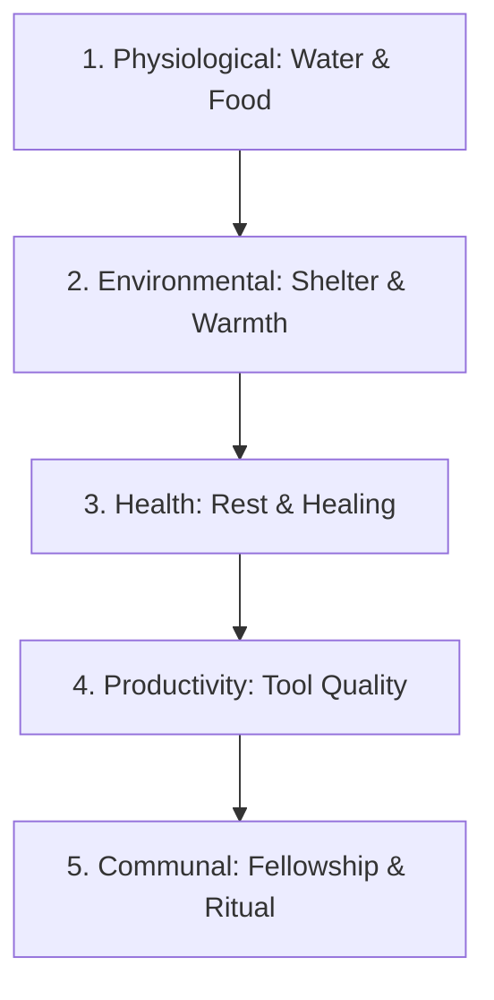

# DEWABHUMI — Citizens & Labor System

> **Villager Physiology, Needs Hierarchy, Autonomous Dispatch, and Pathfinding**

---

## 1. Villager Physiology & Needs Hierarchy

Every settler in **Dewabhumi** is an autonomous physical agent possessing independent physiological states:

### Needs Specifications
1. **Hydration (Water):**
   - **Consumption Rate:** 2 water units per day.
   - **Behavior:** When hydration falls below 30%, the villager abandons their current task and walks to the nearest Well, Spring, or clean Stream.
   - **Dehydration:** Zero water for 2 consecutive days causes extreme lethargy (-50% speed) and health decline (-10% per day).

2. **Satiety (Food):**
   - **Consumption Rate:** 2 food units (grain, fruit, or milk) per day.
   - **Behavior:** Villagers retrieve food from their home pantry or visit the nearest communal Storehouse during mealtimes (Morning and Evening).
   - **Starvation:** Zero food for 3 days results in starvation damage and eventual death.

3. **Rest & Shelter:**
   - **Home Assignment:** Each villager claims a bed slot inside an authorized dwelling.
   - **Sleep Cycle:** Villagers return to their dwelling at dusk, resting for 6 in-game hours to restore stamina and body heat.
   - **Exposure:** Sleeping outdoors during winter or torrential monsoon rain induces hypothermia and illness.

---

## 2. Professions & Labor Allocation

Villagers are categorized into **Specialized Occupations** or **General Laborers**:

| Occupation | Core Responsibilities | Equipment Used |
|---|---|---|
| **General Laborer** | Resource hauling, basic site clearing, material delivery to blueprints. | Dokoko carrying basket. |
| **Builder** | Assembling structures from delivered materials, repairing degraded buildings. | Wooden mallet, leveling plumb. |
| **Woodcutter** | Felling marked trees, trimming branches, bucking timber into logs. | Iron / Bronze felling axe. |
| **Stonemason** | Quarrying boulders from riverbeds, shaping building stone. | Sledgehammer, iron chisels. |
| **Forager** | Gathering wild mountain berries, roots, medicinal herbs, and reeds. | Gathering pouch, curved knife. |
| **Herder** | Guiding Zebu cattle to pastures, harvesting green fodder, milking cows. | Wooden crook, milking pail. |
| **Farmer** | Plowing terraces, transplanting paddy seedlings, managing irrigation. | Wooden ox-plow, sickle. |
| **Water Carrier** | Transporting water from springs to settlement storage urns and wells. | Earthen pots (*Ghyampo*). |

---

## 3. Autonomous Task Dispatch Engine

The simulation engine maintains a centralized **Task Priority Queue**:
1. **Scoring Function:** When a worker completes a task or becomes idle, the dispatch engine evaluates available tasks using proximity, urgency, and profession compatibility:

$$\text{Score} = w_1 \cdot \text{Priority}_{\text{task}} - w_2 \cdot \text{Distance}_{\text{worker, task}} + w_3 \cdot \text{SkillBonus}$$

2. **No Redundant Dispatch:** Once a worker accepts a task, that task is locked. A second worker will never travel to pick up the same log or fell the same tree.
3. **Interrupt Safety:** If a worker must interrupt a task to drink or sleep, the partially completed work item is safely placed back into the available pool.

---

## 4. Pathfinding & Movement Speeds

- **Grid Algorithm:** Hierarchical A* over the 2.0m settlement logical grid.
- **Path Modifiers:**
  - **Open Meadow / Untamed Ground:** Base movement speed (1.0x = $1.4 \text{ m/s}$).
  - **Beaten Earth Trail:** +20% speed bonus (1.2x).
  - **Paved River-Stone Road:** +40% speed bonus (1.4x), completely immune to monsoon mud penalties.
  - **Steep Slope ($>15^\circ$):** -40% speed penalty unless stone steps are constructed.
  - **Muddy Ground (Monsoon):** -50% speed penalty on unpaved dirt.
