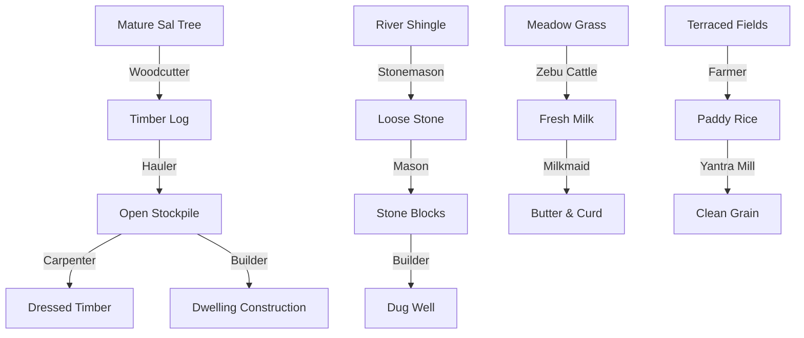

# DEWABHUMI — Economy & Resource System

> **Material Taxonomy, Conservation Invariant, Storage Dynamics, and Supply Chains**

---

## 1. Absolute Conservation Invariant

Every discrete resource unit in **Dewabhumi** obeys an inviolable mathematical invariant:

$$\sum \text{Resources}_{\text{world}} = \sum \text{Unmined Nodes} + \sum \text{Carried Loads} + \sum \text{Stockpile Inventories} + \sum \text{Site Deliveries} - \sum \text{Consumed/Decayed}$$

- **No Magic Currency:** Resources do not exist as floating abstract numbers.
- **Atomic State Transitions:** Moving an item from a stockpile to a hauler is executed as a single atomic operation. No item can exist in two inventories simultaneously, nor can it vanish mid-transit.
- **Deterministic Auditing:** In debug/diagnostic mode (F3), a complete settlement census tallies every physical entity against the ledger. Any discrepancy triggers an immediate assert.

---

## 2. Resource Taxonomy

```
+---------------------------------------------------------------------------------------+
| RESOURCE CATEGORY     | ITEMS INCLUDED                | STORAGE FACILITY              |
+-----------------------+-------------------------------+-------------------------------+
| Raw Building Materials| Timber (Logs), Loose Stone,   | Open Stockpile (Ground pads)  |
|                       | Thatch Reeds, Clay / Mud      |                               |
+-----------------------+-------------------------------+-------------------------------+
| Sustenance & Food     | Fresh Water, Wild Berries,    | Dry Storehouse (Sheltered bins|
|                       | Foraged Greens, Rice, Grain,  | and clay storage urns)        |
|                       | Fresh Milk, Curd / Butter     |                               |
+-----------------------+-------------------------------+-------------------------------+
| Pastoral Supplies     | Green Grass / Meadow Fodder,  | Fodder Store / Elevated Hay   |
|                       | Dried Hay Stacks              | Racks                         |
+-----------------------+-------------------------------+-------------------------------+
| Processed Goods       | Dressed Timber, Stone Blocks, | Dedicated Craft Workshops or  |
| & Equipment           | Fired Bricks, Dokoko Baskets, | Secure Storehouses            |
|                       | Bronze/Iron Tools, Rope       |                               |
+-----------------------+-------------------------------+-------------------------------+
```

---

## 3. Storage Facilities & Environmental Spoilage

### Open Stockpile
- **Base Footprint:** $2 \times 2$ grid cells ($4 \times 4$ metres).
- **Accepted Goods:** Timber logs, rough stone boulders, raw clay blocks.
- **Capacity:** 40 standard units.
- **Exposure:** Immune to rain rot in MVP. Future expansion adds minor weathering decay if exposed to 3 consecutive monsoon cycles.

### Dry Storehouse
- **Base Footprint:** $3 \times 4$ grid cells ($6 \times 8$ metres).
- **Accepted Goods:** Grains, wild food, dried fodder, woven goods, manufactured tools.
- **Capacity:** 200 standard units divided across dedicated bins.
- **Protection:** 100% sheltered from rain and pests. Elevated wooden floorboards prevent ground moisture infiltration.

### Spoilage Rates
- **Fresh Water:** Must be kept in earthenware vessels; does not spoil, but evaporates if stored in open basins during hot pre-monsoon dry season.
- **Fresh Milk:** Spoils within 2 game days if unconsumed or unchurned into butter/curd (*Dahi*).
- **Wild Berries / Greens:** Spoil after 5 game days without smoking/drying.
- **Grain (Barley / Millet / Rice):** Lasts up to 2 full game years if kept in a dry storehouse.

---

## 4. Supply Chain Dependency Chart


