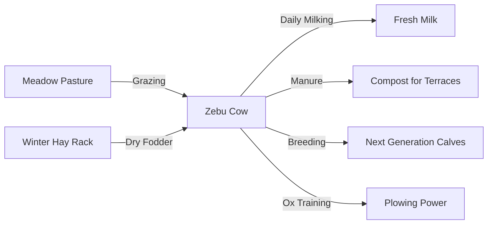

# DEWABHUMI — Herd & Cattle System

> **Zebu Cattle Husbandry, Grazing Ecology, Fodder Conservation, and Milk Logistics**

---

## 1. Central Pastoral Foundation

In **Dewabhumi**, cattle (*Gau*) are not mere livestock; they are the bedrock of the valley community’s survival, wealth, and cultural vitality. The settlement begins with two ancestral Zebu cattle (*Bos indicus*), distinguished by their curved horns, pronounced dorsal humps, and large dewlaps.

---

## 2. Pasture Ecology & Grazing Mechanics

### Pasture Enclosure Designation
- **Mechanism:** The player designates a designated pasture polygon or fenced grid zone.
- **Biomass Capacity:** Each grassy grid cell contains an authoritative `Biomass` integer (100 units max).
- **Grazing Consumption:** An adult Zebu cow consumes 15 biomass units per day.
- **Regrowth Cycle:**
  - **Spring & Monsoon:** Rapid regrowth (+10 biomass per cell per day).
  - **Autumn:** Moderate regrowth (+4 biomass per day).
  - **Winter / Pre-Monsoon Dry:** Zero natural regrowth (0 biomass).
- **Overgrazing Danger:** If a cell is grazed to 0 biomass, the roots die, transforming the soil into packed dirt prone to erosion during the monsoon.

---

## 3. Winter & Dry Season Fodder

To survive the months when valley meadows turn brown:
1. **Hay Harvest:** In late summer, herders scythe highland meadows, bundling green grass into hay sheaves.
2. **Elevated Drying Racks (*Macha*):** Hay is dried off the damp ground on wooden racks to prevent rot.
3. **Stored Feeding:** In winter, herders pull dried hay from storage to feed cattle inside the barn (*Goth*). A cow fed dry hay produces 70% of normal milk volume.

---

## 4. Milk Logistics & Processing

- **Milking Window:** Cows produce milk once daily at dawn if health is above 70%.
- **Daily Yield:** 4 units of Fresh Milk per lactating cow per day.
- **Perishability:** Fresh milk has a short shelf life (2 game days).
- **Curd & Butter (*Ghee*):**
  - Milkmaids churn excess milk in wooden cylindrical churns (*Theki*) using a corded paddle (*Madani*).
  - 4 Milk -> 2 Butter/Ghee + 2 Buttermilk (*Mahi*).
  - Butter/Ghee stores safely for months in sealed clay jars without spoiling.
