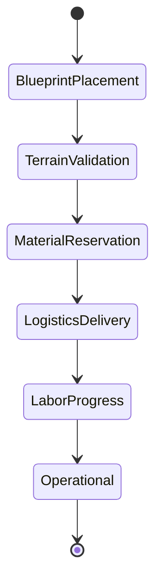

# DEWABHUMI — Settlement & Buildings Catalog

> **Blueprint Lifecycle, Architectural Hierarchy, Metric Footprints, and Construction Requirements**

---

## 1. Blueprint Construction Lifecycle

Every building project in **Dewabhumi** advances through six discrete, verifiable stages:

1. **Blueprint Placement:** The player selects a building from the HUD Build Bar and positions the ghost footprint.
2. **Spatial Validation:** Engine verifies ground slope ($\le 15^\circ$), obstacle clearance, water buffers, and entrance accessibility.
3. **Material Reservation:** Simulation reserves required components from existing stockpiles (atomic lock).
4. **Logistics Delivery:** Haulers transport reserved logs, stones, and thatch bundles to the construction foundation.
5. **Labor Progress:** Assigned builders hammer, chisel, and assemble materials; labor ticks advance from 0% to 100%. The visual mesh transitions across the 3 construction stages (Ground Prep -> Framing/Scaffold -> Finished).
6. **Operational State:** The building transitions to active service, registering dwelling beds, storage slots, or production roles.

---

## 2. Core Building Catalog (Production Specifications)

### A. Civic & Infrastructure

#### Central Camp / Founder's Chautara
- **Footprint:** $4 \times 4$ cells ($8.0\text{ m} \times 8.0\text{ m}$).
- **Max Height:** $6.5\text{ m}$.
- **Construction Cost:** Starting structure (Free).
- **Function:** Initial community meeting ground, small dry storage buffer (holds 20 units), emergency rain shelter for founders.
- **Architectural Style:** Massive sacred Pipal/Banyan tree surrounded by a raised dry-stone terrace platform ($0.5\text{ m}$ height) with carved wooden benches and a sheltered clan shrine.

#### Dug Well (*Kuwa*)
- **Footprint:** $1 \times 1$ cell ($2.0\text{ m} \times 2.0\text{ m}$).
- **Max Height:** $2.4\text{ m}$.
- **Construction Cost:** 12 Loose Stone, 4 Timber.
- **Function:** Provides continuous clean water within a 15-cell radius. Reduces water gathering transit time by 80%.
- **Architectural Style:** Circular stone masonry rim with a counterweighted wooden draw-beam (*Dhenki* style) and gravel drainage apron.

#### Dirt Track & Paved Stone Road
- **Footprint:** $1 \times 1$ cell ($2.0\text{ m} \times 2.0\text{ m}$).
- **Cost (Dirt Track):** 0 materials (cleared by labor).
- **Cost (Paved Road):** 2 Loose Stone per cell.
- **Function:** Increases travel speed (+20% for dirt, +40% for paved), prevents monsoon mud bogging, channels village layout.

#### Stream Crossing / Bridge Module
- **Footprint:** $1 \times 2$ cells ($2.0\text{ m} \times 4.0\text{ m}$).
- **Max Height:** $1.2\text{ m}$ (Handrails).
- **Construction Cost:** 8 Timber, 6 Loose Stone.
- **Function:** Spans natural waterways and irrigation channels, allowing unhindered movement of villagers and cattle.

---

### B. Dwellings & Shelter

#### Simple Thatched Dwelling (*Ghar*)
- **Footprint:** $2 \times 3$ cells ($4.0\text{ m} \times 6.0\text{ m}$).
- **Max Height:** $3.8\text{ m}$ (Gable Ridge).
- **Construction Cost:** 10 Timber, 8 Loose Stone, 6 Thatch.
- **Capacity:** 4 Villagers.
- **Function:** Provides rest, warmth, night shelter, and personal household pantry storage (holds 10 food units).
- **Architectural Style:** Whitewashed red-clay plaster walls, heavy timber post-and-beam frame, steep gabled thatch roof, carved wooden window grilles (*Aakhi Jhyal*).

#### Upgraded Stone House
- **Footprint:** $3 \times 3$ cells ($6.0\text{ m} \times 6.0\text{ m}$).
- **Max Height:** $5.5\text{ m}$ (2-Story Ridge).
- **Construction Cost:** 18 Timber, 22 Loose Stone, 10 Thatch / Tiles.
- **Capacity:** 8 Villagers.
- **Function:** High-density, warm two-story housing. Upper floor holds sleeping quarters; ground floor provides dry storage.

#### Clan Longhouse
- **Footprint:** $3 \times 6$ cells ($6.0\text{ m} \times 12.0\text{ m}$).
- **Max Height:** $5.8\text{ m}$.
- **Construction Cost:** 24 Timber, 18 Loose Stone, 14 Thatch.
- **Capacity:** 12 Villagers.
- **Function:** Communal shelter for early settlement stages or large extended clans.

---

### C. Storage & Production

#### Open Stockpile & Tool Shed
- **Footprint:** $2 \times 2$ cells ($4.0\text{ m} \times 4.0\text{ m}$).
- **Max Height:** $2.8\text{ m}$ (Lean-to).
- **Construction Cost:** 6 Timber, 4 Loose Stone.
- **Capacity:** 40 standard units of raw materials (Timber logs, boulders, clay).
- **Function:** Central drop-off point for heavy materials; open lean-to tool rack for felling axes and pickaxes.

#### Communal Dry Granary (*Bhakari*)
- **Footprint:** $3 \times 4$ cells ($6.0\text{ m} \times 8.0\text{ m}$).
- **Max Height:** $4.5\text{ m}$.
- **Construction Cost:** 16 Timber, 12 Loose Stone, 10 Thatch.
- **Capacity:** 200 standard units of perishable foods, grains, dried fodder, and woven goods.
- **Architectural Style:** Raised on $0.60\text{ m}$ anti-vermin stone stilts with tight-fitting timber floorboards and sealed clay plaster.

#### Woodcutter's Post
- **Footprint:** $2 \times 2$ cells ($4.0\text{ m} \times 4.0\text{ m}$).
- **Max Height:** $2.6\text{ m}$.
- **Construction Cost:** 6 Timber, 4 Loose Stone.
- **Capacity:** 2 Woodcutters.
- **Function:** Designates tree felling zones, provides a chopping block to convert logs into dressed planks.

#### Forager's Lodge
- **Footprint:** $2 \times 2$ cells ($4.0\text{ m} \times 4.0\text{ m}$).
- **Max Height:** $2.8\text{ m}$.
- **Construction Cost:** 6 Timber, 4 Thatch.
- **Capacity:** 2 Foragers.
- **Function:** Designates collection circles for wild greens, forest berries, and medicinal roots. Includes drying racks to extend food shelf life.

---

### D. Pastoral & Hydraulic Farming

#### Cattle Barn & Enclosure (*Goth*)
- **Footprint:** $4 \times 4$ cells ($8.0\text{ m} \times 8.0\text{ m}$).
- **Max Height:** $4.2\text{ m}$.
- **Construction Cost:** 16 Timber, 10 Loose Stone, 8 Thatch.
- **Capacity:** 4 Zebu Cattle, 2 Herders.
- **Function:** Shelters cattle during the night and winter; collects organic fertilizer; central milking point.
- **Architectural Style:** Heavy timber pen with hay loft overhead and sloped cobblestone drainage.

#### Yantra Watermill (*Pani Ghatta*)
- **Footprint:** $3 \times 3$ cells ($6.0\text{ m} \times 6.0\text{ m}$).
- **Max Height:** $3.6\text{ m}$.
- **Construction Cost:** 18 Timber, 14 Loose Stone, 6 Thatch.
- **Capacity:** 1 Miller.
- **Placement Requirement:** Must straddle an active stream or irrigation canal (*Kulo*).
- **Function:** Water-driven granite millstones grind grains into flour at 10x manual speed.

#### Sacred Shrine / Stupa
- **Footprint:** $2 \times 2$ cells ($4.0\text{ m} \times 4.0\text{ m}$).
- **Max Height:** $4.5\text{ m}$.
- **Construction Cost:** 16 Loose Stone, 4 Dressed Timber, 2 Brass / Clay ornaments.
- **Function:** Boosts village spiritual contentment, serves as a social gathering hub, reduces fatigue.
