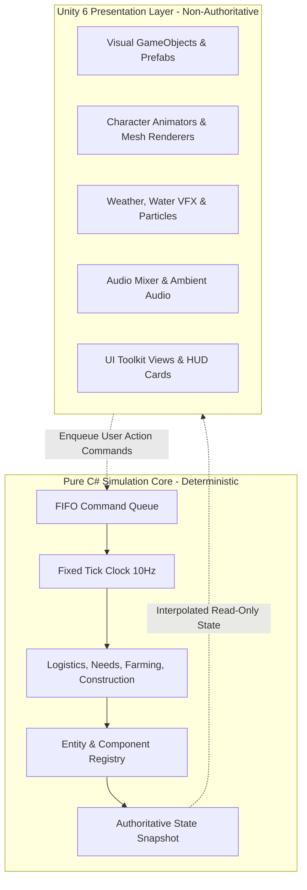

# DEWABHUMI — Simulation Architecture

> **Fixed-Tick Determinism, Entity State Registry, Presentation Decoupling, and Persistence**

---

## 1. Architectural Overview & Presentation Decoupling

**Dewabhumi** employs a strict two-layer architecture:

### Core Principles
1. **Simulation Authority:** The simulation core is pure C# with zero dependencies on `UnityEngine.Object` or Unity physics.
2. **Fixed Cadence:** Ticks advance at a locked 10 Hz (0.1s per tick). Frame rates (30, 60, 144 FPS) have zero impact on economic simulation outcomes.
3. **Decoupled Presentation:** Presentation components interpolate visual transforms between authoritative tick snapshots. If the rendering engine hitches, game logic remains perfectly deterministic.

---

## 2. Entity Registry & Stable Identification

- **Stable Entity IDs:** Every entity (Villager, Cow, Stockpile, Tree, Building Site, Resource Item) is assigned an immutable 64-bit integer `EntityId`.
- **Component Storage:** Data is stored in contiguous, cache-friendly component arrays:
  - `PositionComponent` (Integer grid coordinates $X, Z$)
  - `PhysiologyComponent` (Hydration, Satiety, Rest, Health)
  - `InventoryComponent` (Item slots, weight, volume, reservations)
  - `TaskComponent` (Current task ID, progress ticks, tool requirement)

---

## 3. Save / Load & State Serialization

The entire game state serializes into a compact, schema-validated JSON / binary snapshot:
- **Zero Loss Contract:** Saving during active tasks (e.g., a hauler mid-step carrying a log, or a builder with 42% progress on a dwelling) preserves:
  - Worker coordinates and step fraction.
  - Carried load and reservations.
  - Construction site labor ticks and delivered goods.
- **Schema Versioning:** Every save file includes a header `schema_version`. Breaking schema upgrades include automated forward migration steps.
