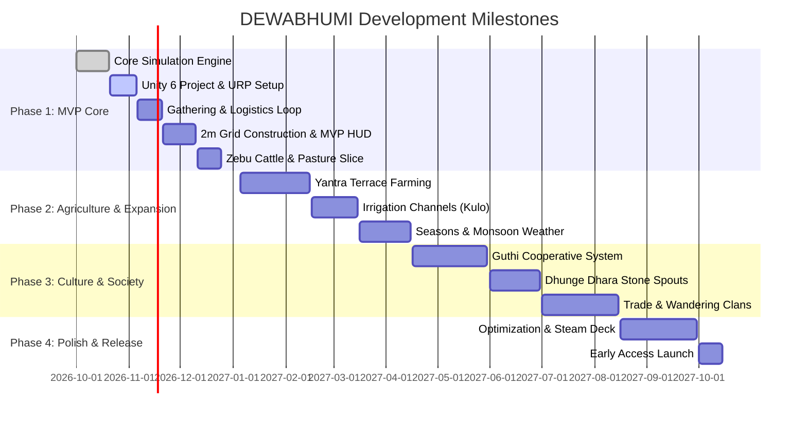

# DEWABHUMI — Phased Development Roadmap

> **Milestones, Deliverables, and Acceptance Gates**

---

## Roadmap Overview

---

## Phase Details

### Phase 1: MVP Survival & Pastoral Sanctuary (Current Target)
- **Deliverables:**
  - Founder's Chautara camp with 8 starting villagers and 2 Zebu cattle.
  - Dedicated gathering of Timber, Loose Stone, Thatch, Wild Greens, and Water.
  - Physical hauling with Dokoko baskets and strict inventory limits.
  - 2m settlement grid placement of Dwellings, Open Stockpile, Dry Storehouse, and Well.
  - Autonomous villager task dispatch and pathfinding on beaten paths.
  - Zebu cattle grazing, biomass depletion, fodder feeding, and daily milk yield.
  - Desktop HUD with Farthest Frontier layout (Top status bar, time controls, build bar, selection cards).
  - Robust mid-task save/load with 100% state conservation.

### Phase 2: Valley Expansion & Yantra Terracing
- **Deliverables:**
  - Terraced field construction (*Khet* and *Bari*).
  - Gravity-fed irrigation canals (*Kulo*) with diversion weirs.
  - Wet paddy rice cultivation (*Ropain*) and crop rotation (millet, barley, mustard).
  - Water-powered hydraulic machinery (Traditional *Pani Ghatta* watermill).
  - Dynamic monsoon weather system with swollen rivers and mud hazards.

### Phase 3: Cultural Institutions & Commerce
- **Deliverables:**
  - *Guthi* cooperative labor trusts for grand community monuments.
  - Ancient stone water conduits (*Dhunge Dhara*).
  - Trade caravans arriving through mountain passes.
  - Extended artisan workshops (Pottery, Blacksmith, Weavers).

### Phase 4: Release Polish & Optimization
- **Deliverables:**
  - 60 FPS performance optimization on target hardware (including Steam Deck).
  - Full localization support.
  - Complete audio soundscape (Himalayan ambient winds, birdsong, traditional flutes).
