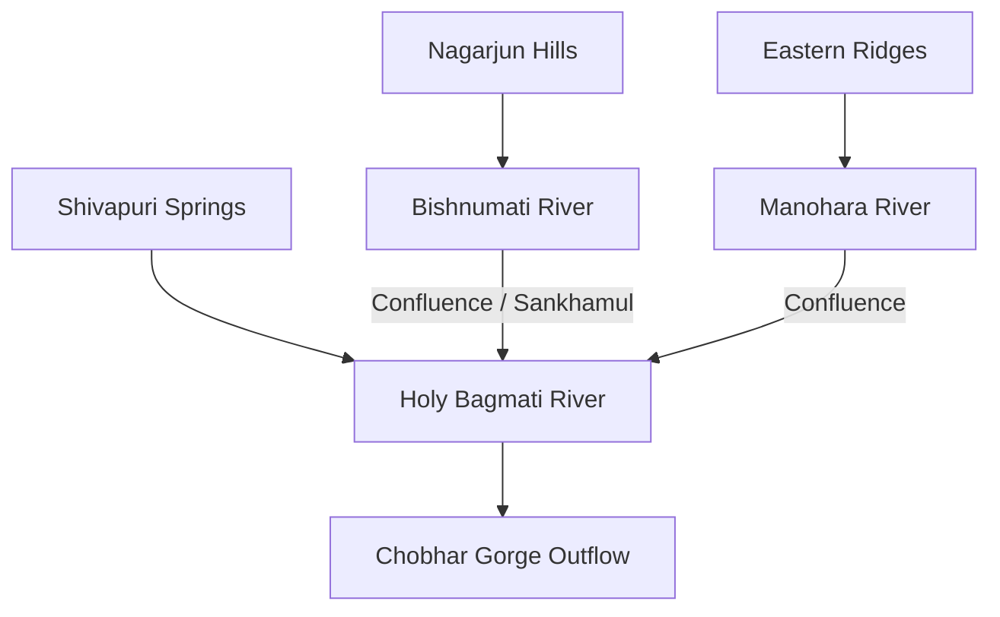

# DEWABHUMI — World & Kathmandu Valley Geography

> **Topography, Lacustrine Heritage, Hydrological Flow, and Himalayan Micro-Climates**

---

## 1. The Ancient Lacustrine Basin

The setting of **Dewabhumi** is inspired by the unique geological bowl of the Kathmandu Valley:
- **Ancient Lake Nagdaha:** Legend and geology tell of an ancient mountain lake that filled the basin. Drained through the Chobhar gorge, it left behind deep, incredibly fertile lacustrine sediments (*Kalimati* or 'black clay'), perfect for pottery, mud brick, and intensive farming.
- **Topographic Bowl:** The valley floor sits at approximately 1,300 to 1,400 metres above sea level, enclosed by towering Himalayan outer ridges rising to 2,700 metres (Shivapuri to the north, Phulchowki to the south, Chandragiri to the west, and Nagarkot to the east).

---

## 2. River Systems & Hydrology

Water is life, transport, and boundary in the valley:

- **River Widths:**
  - **Bagmati River:** 64 metres artistic rendered width (main sacred artery).
  - **Major Tributaries (Bishnumati, Manohara):** 44 metres rendered width.
  - **Mountain Streams (*Kholsa*):** 20 metres down to narrow 2m hillside freshets.
- **Seasonal Surges:** During the peak monsoon (July/August), river volumes swell tenfold, depositing nutrient-rich silt along low terraces while threatening poorly sited dwellings.

---

## 3. Native Flora & Himalayan Biomes

- **Sal Forest (*Shorea robusta*):** Dense, hardwood timber growing along valley floor alluvial plains and lower foothills. Highly resistant to rot and termites; ideal for heavy structural beams.
- **Himalayan Alder (*Utis*):** Fast-growing soft timber colonizing moist ravines and landslides; excellent for firewood and temporary huts.
- **Sacred Fig (*Pipal / Bar*):** Massive shade trees planted at crossroads and meeting mounds (*Chautara*).
- **Sub-Alpine Conifers:** Chir pine and blue pine on dry northern ridges; rhododendron forests on higher cloud-shrouded summits.
